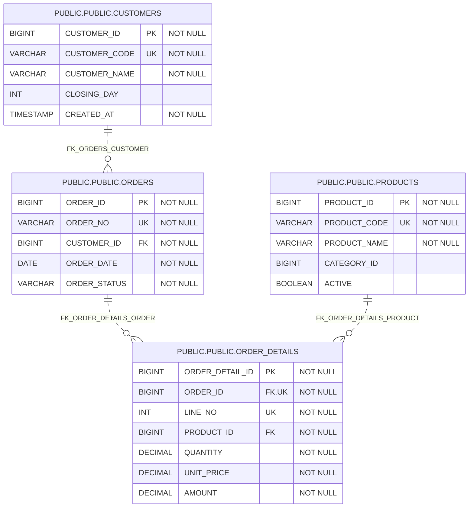

# Explore a generated business database reference

[Getting started](README.md)

This saved output comes from the `sqlapp-gradle-example` project supplied for
public documentation. It contains 20 table pages for customers, orders,
shipments, invoices, payments, and inventory. The generated overview identifies
HSQL Database Engine 2.7.4 and a generation time of 2026-10-11 17:39:23.

## Start with the whole database

Open the [HTML overview](../examples/gradle-html/index.html), then the
[table list](../examples/gradle-html/tables.html). Use the
[whole-schema ER diagram](../examples/gradle-html/diagrams/PUBLIC.svg) to trace
relationships across business areas. The
[logical-name diagram](../examples/gradle-html/diagrams/PUBLIC_logical.svg)
is also included; displayed logical names depend on dictionary coverage.

The value is a connected reference: move from relationships to the table's
columns, keys, and generated DDL instead of maintaining separate inventories.

## Focus a discussion on orders

Open the [order viewpoint diagram](../examples/gradle-html/diagrams/viewpoint-order.svg)
to inspect the selected order-related tables. A viewpoint presents a named
subset of the same schema, helping a discussion stay focused while retaining
the full database reference.

The [generated Mermaid source](../examples/gradle-html/diagrams/viewpoint-order.mmd)
is included alongside the SVG for reuse in tools that support Mermaid.
See [viewpoint configuration](../schema/html-documentation.md#viewpoints-and-dictionaries)
for defining your own subsets.

The four-table viewpoint below is the generated Mermaid output, copied without
changing table identifiers or relationships:



Read it from customer to order to order detail. Each order references a customer;
each detail references its order and product. This lets a reviewer answer
"which tables describe an order?" without tracing inventory and invoicing at
the same time. A viewpoint selects tables; it does not create database views or
change the source schema.

## Inspect a concrete table

Open [ORDERS](../examples/gradle-html/tables/PUBLIC_ORDERS.html), then compare
[ORDER_DETAILS](../examples/gradle-html/tables/PUBLIC_ORDER_DETAILS.html) and
[CUSTOMERS](../examples/gradle-html/tables/PUBLIC_CUSTOMERS.html). Inspect the
column types, keys, relationships, and DDL to see how the diagram connects to
implementation details.

Use this short walkthrough to connect business questions to schema details:

| Question | Where to look | What the saved schema shows |
|---|---|---|
| Who placed an order? | ORDERS → CUSTOMERS | `CUSTOMER_ID` references the customer table |
| Which products were ordered? | ORDER_DETAILS → PRODUCTS | `PRODUCT_ID` links each detail to its product |
| How are lines identified within an order? | ORDER_DETAILS keys | `ORDER_DETAIL_ID` is the primary key; inspect the unique key containing `ORDER_ID` and `LINE_NO` |
| What values describe an order line? | ORDER_DETAILS columns | Quantity, unit price, and amount are modeled separately |

These are structural observations from the saved output. They do not establish
application rules such as how amounts are calculated or whether orders may be
deleted.

## Reproduce and maintain this example

The source project configures `generateHtmlDocs` with a saved Schema XML under
`schemas/baseline`, dictionaries under `src/main/dictionaries`, viewpoints in
`src/main/viewpoint/viewpoint.yaml`, and foreign-key definitions under
`src/main/foreignkey`. Its output directory is `html/`.

From that sample project's root, with its input files and dependencies present:

```shell
./gradlew generateHtmlDocs
```

On Windows, use `.\gradlew.bat`. This command is documented from the supplied
build configuration; it was not rerun when copying this snapshot. For setup in
your own project, follow the [Gradle quick start](../gradle-plugin/getting-started.md).
The [small offline demo](offline-demo.md) remains available in this repository.

The files under `docs/examples/gradle-html` are an intentional copy of the full
45-file output, preserving relative navigation between HTML pages and diagrams.
Regenerate in the source project and replace the snapshot together when updating
it. Do not edit individual generated pages. The original project is unchanged.

Open the copied `index.html` locally or serve this directory as static files to
browse it; repository file views may show HTML source instead of rendering it.
Some sorting and syntax-highlighting resources are loaded from external CDNs,
so those enhancements depend on network access. Local file targets were checked;
browser appearance and CDN availability were not verified for this snapshot.
